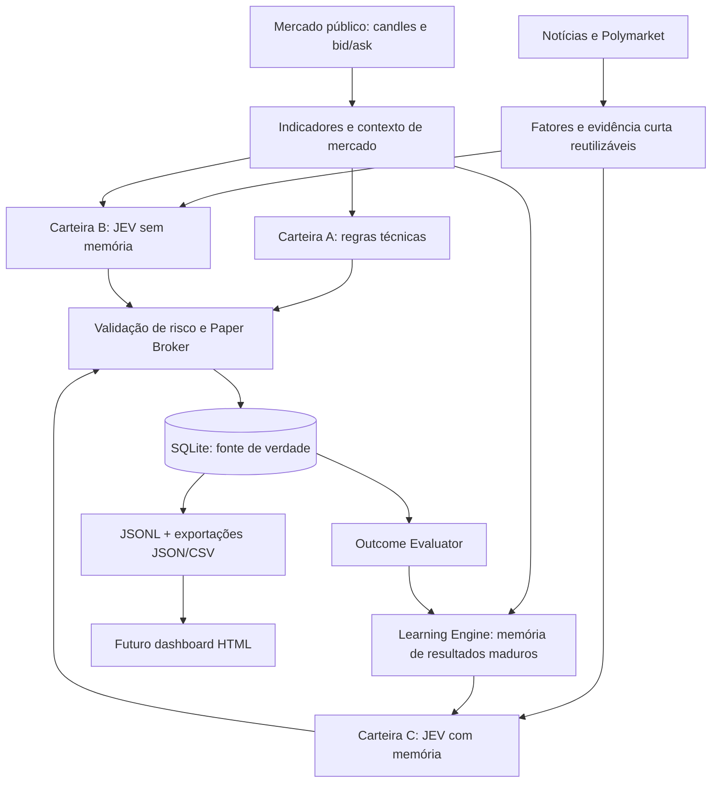

# ai-trade-memory

**Contexto externo aprovado:** notícias e Polymarket com fatores separados e evidência curta, mesma base B/C; critérios e políticas D002/D018–D049 no [contrato vigente](docs/SPEC.md). P012 encerrado para discussão; detalhes técnicos serão resolvidos na implementação, de forma proporcional à POC. Implementação/validação pendentes.

**D030 — suporte a outros ativos na V1:** um par Spot configurável com cotação USDT por sessão, selecionado antes de iniciar; BTC é exemplo/default. Banco, trio A/B/C e memória por símbolo permanecem separados. Quantidades, metadados, feeds, prompts e contexto usam o ativo destino. Retomada mantém o par salvo; transferência separada integra V1 conforme D052/SPEC 10.10. [Contrato vigente, seção 4.3](docs/SPEC.md). Implementação pendente.

**Descoberta Polymarket D031:** até 100 registros/página e cinco requisições físicas por revisão inicial/60m, incluindo retries/todos os temas da sessão; até dez mercados acompanhados, mesma seleção B/C. Registrar limites/cobertura parcial e impedir loops. Detalhes e regras posteriores no [contrato vigente](docs/SPEC.md).

**Laboratório de negociação simulada de criptomoedas com IA probabilística e aprendizado contínuo.**

> O mercado fornece os dados. O JEV avalia as decisões. O nosso motor de memória aprende com os resultados.

**Status:** documentação V1 fechada; implementação pendente · **Linguagem:** Python 3.11+ · **Modo:** `PAPER_ONLY`

## Documentação fechada

[Escopo V1](docs/ESCOPO_POC_V1.md) · [SPEC 1.50](docs/SPEC.md) · [Backlog técnico](docs/BACKLOG_IMPLEMENTACAO.md) · [Índice](docs/README.md).

D050–D052 consolidam motores por sessão/Docker, orçamento global e V1 com transferência automática, REST/WSS/token/2FA e TUI remota após núcleo. [Plano ordenado E00–E11](docs/PLANO_DESENVOLVIMENTO_V1.md) · [Status](docs/STATUS_DESENVOLVIMENTO.md). Sem microaprovações; detalhes rotineiros são implementação/testes. Este repositório ainda contém documentação/referências: comandos abaixo descrevem a entrega prevista, não programas disponíveis ou integração testada.

## Visão geral

O **ai-trade-memory** é uma prova de conceito (POC) para investigar se um motor próprio de aprendizado contínuo pode melhorar decisões de negociação de criptomoedas.

O sistema observa **dados reais de mercado**, calcula indicadores técnicos, coleta notícias e consulta o **JEV 1.13**, por meio do **OpenRouter**, para avaliar as ações `BUY`, `SELL` ou `HOLD`. As ordens e carteiras são **100% virtuais**: nenhum dinheiro é negociado em corretoras.

Mais do que simular lucro, a POC busca responder:

1. Uma estratégia com JEV, notícias e expectativas do Polymarket supera as regras técnicas de referência?
2. Fornecer ao JEV o histórico estruturado de erros e acertos melhora suas decisões?
3. A melhoria, se existir, compensa o **custo real** das chamadas ao OpenRouter?

**Importante:** o JEV **não é retreinado** pelo projeto. O aprendizado acontece em um componente Python próprio, que avalia decisões passadas, consolida padrões estatísticos e fornece esse contexto nas próximas chamadas ao modelo.

## Como o experimento funciona

Três estratégias independentes acompanham o mesmo mercado e começam, cada uma, com **100 USDT fictícios**:

| Carteira | Identificador | Estratégia | O que mede |
| --- | --- | --- | --- |
| **A** | `BASELINE_TECHNICAL` | Indicadores e regras fixas, sem IA | Referência quantitativa |
| **B** | `JEV_STATIC` | Indicadores, notícias por API, Polymarket e JEV, sem memória | Contribuição da estratégia enriquecida completa |
| **C** | `JEV_LEARNING` | Mesmo JEV + contexto do Learning Engine | Contribuição do aprendizado |

Cada carteira tem saldo, posições, ordens e resultados próprios. **Não** são 300 USDT em uma carteira única: são três cenários comparativos com 100 USDT cada.

Pelas [decisões D009/D010](docs/DECISIONS.md), escolher explicitamente o perfil antes de criar uma sessão, com banco e trio A/B/C próprios. Nova sessão inicia capital novo; restauração recupera configuração/perfil, carteiras, memória e histórico sem reset. O usuário pretende operar dois perfis após homologação: serão duas sessões e seis carteiras independentes, com orçamento de IA global coordenado. Catálogo inicial `trend_15m_v1`; outros estilos exigem contratos próprios; consultar [perfis e sessões](docs/PERFIS_E_SESSOES.md). HTTP/TUI integram a entrega após Marcos 1–5; HTML e outros estilos são evolução.

[D013](docs/DECISIONS.md) define pré-configuração por estratégia baseada nos documentos, com ajustes antes de criar a sessão e valores efetivos persistidos. Os perfis de uso serão escolhidos na partida entre os implementados/validados; restaurar conserva a configuração salva. Guardar esse requisito para a futura TUI, sem antecipar suas telas/fase.

### Ciclo operacional



A cada **candle fechado de 15 minutos**, o serviço atualiza os dados e avalia as estratégias. A tendência também considera candles de **1 hora**. Cotações públicas podem ser consultadas entre ciclos para monitorar stops e posições abertas.

Todas as simulações são **Spot, long-only**: `BUY` abre uma posição no ativo base configurado; `SELL` encerra a posição existente; `HOLD` não modifica a carteira. Não há short, futuros ou alavancagem.

## Aprendizado contínuo: o diferencial

O **Learning Engine** é independente do JEV. Ele registra o cenário de cada decisão e, quando há dados posteriores suficientes, avalia seu resultado.

- **Memória contextual:** combina regime de mercado, faixas de RSI, volume, volatilidade e situação da carteira.
- **Resultados amadurecidos:** avalia horizontes de **4 e 16 candles**; decisões recentes não entram prematuramente na memória.
- **Comparação contrafactual:** verifica oportunidades não executadas (`HOLD`) sem lançar negociações fictícias na carteira.
- **Estatísticas rastreáveis:** amostras, taxas de acerto, retorno líquido médio, incerteza e período observado.
- **Contexto compacto:** envia ao JEV da carteira C somente os padrões relevantes e suficientemente amostrados.

Pela [decisão D003](docs/DECISIONS.md), todos os grupos preservam execução/perfil, símbolo, posição, família do resultado e horizonte. O nível específico exige 30 resultados amadurecidos; o fallback por regime exige 50. Quando insuficientes, o contexto informa a ausência de amostras. A janela permanece de 60 dias e o limite é de três padrões. [D014](docs/DECISIONS.md) aprova labels contrafactuais amadurecidos de A/B/C como fontes da memória de C, contando avaliações equivalentes uma vez e preservando todas as origens. Dependência entre candles consecutivos permanece reservada em P008; exemplos únicos não comprovam independência.

A V1 usa **aprendizado estatístico e contextual**, não redes neurais nem ajuste automático dos pesos do JEV. Os parâmetros de risco e os limiares da estratégia permanecem fixos durante a comparação. Uma perda isolada não é automaticamente tratada como erro do modelo.

Pela [decisão D006](docs/DECISIONS.md), falta de bid válido nos 90s após o horizonte produz label `UNAVAILABLE`, excluído da memória, com motivo e cobertura reportados. Backfill de candles não substitui cotações ausentes; não há fonte histórica adicional na V1.

Pela [decisão D007](docs/DECISIONS.md), importar/exportar [dataset acumulativo de aprendizado](docs/DATASET_APRENDIZADO.md) permite iniciar C com amostras compatíveis de outras execuções, mediante vínculo explícito que preserva a origem. Cada nova revisão reúne histórico válido e novos resultados amadurecidos, sem duplicar amostras ou sobrescrever versões. O arquivo histórico pode superar 60 dias; memória ativa mantém janela, símbolo, mínimos e contexto compacto. B e saldos não recebem histórico importado. Implementação pendente; transferência estatística separada integra V1 em D052/10.10, e D030 permite outros ativos na V1 em sessões independentes. Aumentar o acervo não comprova maior precisão.

Pela [decisão D008](docs/DECISIONS.md), preservar memória específica por ativo. O pedido posterior D052 inclui transferência automática separada na V1, com normalização, origem, validação prospectiva e ativação/suspensão em [TRANSFERENCIA_APRENDIZADO.md](docs/TRANSFERENCIA_APRENDIZADO.md). Não somar amostras BTC aos mínimos locais de outra moeda; melhoria exige avaliação real.

Para evitar conclusões artificiais, somente informações efetivamente disponíveis **antes de cada decisão** poderão influenciá-la (*sem look-ahead*). A POC não pressupõe que as probabilidades do JEV sejam probabilidades calibradas de lucro.

## Configuração inicial da POC

| Parâmetro | Valor inicial |
| --- | --- |
| Mercado | Par Spot configurável com cotação USDT; um por sessão (BTC/USDT é exemplo). |
| Capital | `100 USDT` por carteira |
| Intervalo principal | `15m` |
| Confirmação de tendência | `1h` |
| Indicadores | RSI, MACD, EMA, ATR e volume relativo |
| Alocação máxima por compra | 20% do patrimônio, limitado ao caixa disponível; orçamento inclui a taxa de entrada |
| Stop-loss / take-profit | 1,5% / 3,0% (valores experimentais) |
| Trava de perda diária | 5% do patrimônio de referência do início do dia UTC, por carteira: encerra posição e bloqueia compras até o próximo dia |
| Taxa simulada | 0,10% por lado |
| Slippage simulado | 0,05% por lado |
| Modelo | `typesafe/jev-1.13` via OpenRouter |
| Tentativas JEV por pedido | Até duas totais: inicial e uma repetição por falha transitória, respeitando orçamento e prazo |
| Probabilidade mínima da ação | 0,65, com margem mínima de 0,10 sobre a segunda opção |
| Memória | Janela móvel de 60 dias; padrões com amostragem mínima |
| Persistência | SQLite + eventos JSONL + exportações JSON/CSV |

Esses valores são **hipóteses iniciais de pesquisa**, não parâmetros otimizados nem recomendações de investimento. A especificação técnica completa está disponível em [`docs/SPEC.md`](docs/SPEC.md).

Pela [decisão D004](docs/DECISIONS.md), a trava diária usa caixa mais o ativo base marcado ao bid e permanece após restart ou recuperação intradia. Encerramento exige cotação fresca; sem ela, a saída fica pendente. A reativação no novo dia UTC exige referência válida e demais condições de entrada; a virada não cancela proteção ainda pendente.

## Arquitetura Python

A [base hexagonal com Docker Compose](docs/ARQUITETURA.md) está aprovada em P016/D012: núcleo separado das integrações, um motor/container por sessão e armazenamento local persistente. Ainda não há bot ou deploy Docker implementado. D011 aprova o primeiro perfil contínuo `trend_15m_v1`; o segundo perfil e protocolo do orçamento global permanecem em definição.

O projeto está planejado como um serviço modular, sem frontend e sem dependências de infraestrutura desnecessárias:

```text
ai-trade-memory/
├── AGENTS.md                 # Orientações para agentes de programação
├── README.md
├── pyproject.toml
├── Dockerfile                # Imagem comum (prevista)
├── compose.yaml              # Um motor por sessão (previsto)
├── .env.example
├── config/
│   └── default.yaml
├── docs/
│   └── SPEC.md               # Especificação técnica completa
├── src/
│   └── poc/
│       ├── domain/           # Regras, indicadores, finanças paper e estatísticas
│       ├── application/      # Casos de uso, portas e unidade de trabalho
│       ├── adapters/
│       │   ├── inbound/      # CLI e agendamento
│       │   └── outbound/     # Fontes públicas, JEV, SQLite, arquivos e orçamento
│       └── bootstrap.py      # Composição dos adaptadores/configuração
├── tests/
├── deploy/                   # Alternativa systemd (prevista)
└── data/                     # Gerado em execução; ignorado pelo Git
    ├── sessions/RUN_ID/
    │   ├── poc.sqlite3
    │   ├── logs/YYYY-MM-DD/events.jsonl
    │   └── exports/
    │       ├── dashboard-latest.json
    │       ├── decisions.csv
    │       ├── fills.csv
    │       └── ai_usage.csv
    └── datasets/              # Arquivos portáveis versionados
```

**Tecnologias previstas:** Python 3.11+, `asyncio`, `httpx`, Pydantic, SQLite, pandas/NumPy, biblioteca de indicadores técnicos, `pytest` e `ruff`.

O banco **SQLite é a fonte de verdade**. Os arquivos JSONL e JSON/CSV são derivados dos registros persistidos e podem ser reconstruídos. Isso prepara o projeto para um dashboard HTML simples, sem criar servidor web na V1.

## Integrações externas

| Serviço | Uso | Segurança |
| --- | --- | --- |
| **Binance Public Market Data** | Candles e preços públicos | Apenas leitura, sem credenciais de exchange |
| **API de notícias cripto** | Marketaux gratuito 30m + RSS complementar/alternativo 10m (D015/D016/D017); filtros/paginação/quota pendentes | Guardar publicação, primeira coleta, proveniência e limites/cobertura por fonte |
| **Polymarket** | Expectativas de eventos e métricas públicas | Apenas leitura; sem operações na plataforma |
| **OpenRouter / JEV** | Classificação de fatores externos e decisões probabilísticas | Chave em variável de ambiente, nunca nos logs |

A integração do JEV usa a **Decisions API**, e não o endpoint de chat:

```text
POST https://openrouter.ai/api/alpha/decisions
Model: typesafe/jev-1.13
Authorization: Bearer $OPENROUTER_API_KEY
```

O sistema registra `usage.cost`, tokens, latência, modelo e status de cada chamada quando disponibilizados. Custos **reais em USD** do OpenRouter ficam separados do saldo **virtual em USDT**. Chamadas compartilhadas entre B e C não devem ser cobradas duas vezes na contabilidade.

Pela [decisão D005](docs/DECISIONS.md), cada pedido JEV de classificação ou negociação permite uma chamada inicial e uma única repetição (`max_retries: 1`). As tentativas físicas são registradas separadamente, inclusive possível cobrança desconhecida após timeout. Prazo e orçamento podem impedir a repetição; restart preserva o contador. Falha final da decisão resulta em HOLD, com monitoramento de risco ativo.

O desenho aprovado usa **fatores externos com evidência curta**: cálculos do Polymarket são locais; classificações semânticas necessárias usam JEV e são reutilizadas entre decisões e B/C enquanto válidas. Todas as chamadas de classificação entram no mesmo orçamento global de IA. Esse processamento ainda depende de implementação e de critérios detalhados, conforme [D002](docs/DECISIONS.md) e [contexto de fontes](docs/FONTES_DE_CONTEXTO.md).

## Como executar (interface prevista)

> **Atenção:** os comandos abaixo fazem parte do contrato de implementação da POC. Eles estarão disponíveis **após o código Python ser implementado** conforme `docs/SPEC.md`; este README, sozinho, não disponibiliza um bot executável.

Preparação do ambiente:

```bash
python3 -m venv .venv
source .venv/bin/activate
python -m pip install -e ".[dev]"
cp .env.example .env
```

No arquivo `.env`, configurar localmente `OPENROUTER_API_KEY` para as consultas reais ao JEV. Nunca versionar credenciais.

Comandos previstos para execução e manutenção:

```bash
# Inicializar banco e validar componentes offline
python -m poc init-db --config config/default.yaml --run-id RUN_ID --profile trend_15m_v1
python -m poc smoke-offline --config config/default.yaml

# Testar UMA chamada ao OpenRouter (requer chave)
python -m poc smoke-openrouter --config config/default.yaml

# Coletar histórico de mercado sem criar trades retroativos
python -m poc backfill --config config/default.yaml --days 7

# Consultar perfis e iniciar uma nova sessão
python -m poc profiles --config config/default.yaml
python -m poc run --config config/default.yaml --new-session --profile trend_15m_v1

# Restaurar uma sessão existente, sem reinicializar capital
python -m poc run --config config/default.yaml --resume RUN_ID

# Consultar situação e gerar dados para análise
python -m poc status --config config/default.yaml --run-id RUN_ID
python -m poc report --config config/default.yaml --run-id RUN_ID --format json
python -m poc export --config config/default.yaml --run-id RUN_ID --format all
```

Em Linux, o caminho operacional aprovado é **Docker Compose**, com um motor por sessão, volumes locais persistentes e retomada a partir do SQLite. **Systemd** permanece alternativa nativa. Reiniciar o processo **não** reinicializa o capital nem permite duplicar operações. Se o serviço ficar offline, ele recompõe dados e avaliações pendentes, mas não executa ordens retroativas como se tivesse estado online. Os arquivos/comandos de deploy ainda precisam ser implementados e validados.

O banco e os artefatos pertencem à sessão escolhida. `trend_15m_v1` identifica o contrato técnico atual; implementação e homologação continuam pendentes. `--new-session` cria banco novo; `--resume RUN_ID` usa somente o existente, sem transformar erro de restauração em outra sessão. Comandos de dados identificam `--run-id RUN_ID`; o orçamento de IA não multiplica com a quantidade de sessões.

## Logs, métricas e futuro dashboard

O projeto será desenvolvido com observabilidade desde o início:

- **Decisões:** features, notícias disponíveis, contexto da memória, probabilidades, ação proposta, ação validada, motivos de rejeição.
- **Negociações virtuais:** ordens, preço de preenchimento, taxas, slippage, quantidade e PnL realizado.
- **Carteiras:** USDT disponível, ativo base em posição, patrimônio, retorno, exposição e drawdown.
- **Aprendizado:** resultados amadurecidos, padrões, tamanho da amostra e versões da memória.
- **Uso da IA:** chamadas, latência, tokens, falhas, custo efetivo em USD e custo desconhecido quando não houver informação de cobrança.
- **Operação:** heartbeat, falhas de mercado, atrasos de candles, reinicializações e recuperação.

A comparação principal é **C − B**, para avaliar o valor adicionado pelo Learning Engine, destacando o período em que a memória estiver disponível. **B − A** é complementar e avalia o pacote completo com JEV, notícias e Polymarket; não isola exclusivamente a contribuição do modelo. O relatório também avaliará resultado líquido simulado, risco e custo das chamadas da IA. O desenho mantém três carteiras por sessão/perfil; dois perfis após homologação terão trios independentes, conforme D009/D010. Contratos das novas fontes e implementação ainda estão pendentes.

Uma POC que termina com mais de 100 USDT **não comprova, por si só, vantagem estatística nem rentabilidade futura**. O objetivo é coletar evidências reproduzíveis, inclusive quando o desempenho for negativo.

O futuro frontend HTML poderá consumir `data/sessions/RUN_ID/exports/dashboard-latest.json` e os CSV. **A V1 inclui TUI terminal conectada aos motores após o núcleo; HTML permanece futuro.** Fase/fluxo remotos definidos em SPEC 15.4/D051.

## Garantias e limitações

- **Nenhuma ordem real:** sem depósitos, saques, credenciais de corretora ou rotas privadas para enviar ordens.
- **Falha segura:** sem preços válidos ou resposta confiável do JEV, não abrir posições por inferência.
- **Risco acima da IA:** saldo, stop-loss, take-profit, limites e estado da posição prevalecem sobre qualquer sugestão do modelo.
- **Auditoria:** configurações, decisões, resultados e custos devem ser reproduzíveis e rastreáveis.
- **Pesquisa, não aconselhamento:** o projeto é experimental e não representa promessa de ganhos financeiros.

## Roadmap da V1

- [ ] Estrutura Python, configuração, banco, broker virtual e testes offline.
- [ ] Coleta pública de mercado, indicadores e execução contínua sem duplicações.
- [ ] Integração OpenRouter/JEV, carteiras A/B/C e apuração de custos reais da IA.
- [ ] Outcome Evaluator, rótulos amadurecidos e Learning Engine contextual.
- [ ] Transferência automática entre moedas com catálogo/normalização/validação/gates.
- [ ] Core REST/WSS/token/2FA/lifecycle server-side e TUI V1 local/remota.
- [ ] Notícias e Polymarket, fatores com evidência curta e reutilização, relatórios, JSONL/CSV/JSON, operação com Docker Compose, alternativa systemd e testes de aceite.

**Documentação de implementação:** [`docs/SPEC.md`](docs/SPEC.md) define as regras e invariantes obrigatórias; [`AGENTS.md`](AGENTS.md) orienta os agentes de programação. Em caso de divergência, a especificação técnica é a referência para implementação.

**Contextos de desenvolvimento e operação:** [`docs/README.md`](docs/README.md) organiza a pesquisa de estilos de trade, as instruções para desenvolvimento e execução, o conteúdo proposto para uma futura TUI e os pontos reservados para discussão. Outros perfis dependem de contratos próprios; a TUI V1 está definida e aguarda implementação.

## Referências

- [TypeSafe AI — JEV](https://docs.typesafe.ai/introduction)
- [OpenRouter — JEV 1.13](https://openrouter.ai/typesafe/jev-1.13)
- [OpenRouter — Decisions API](https://openrouter.ai/docs/api/api-reference/alphadecisions/submit-a-decisions-request)
- [Binance — dados públicos de mercado](https://github.com/binance/binance-spot-api-docs/blob/master/faqs/market_data_only.md)

---

*ai-trade-memory — decisões probabilísticas, memória própria e evidência mensurável.*
