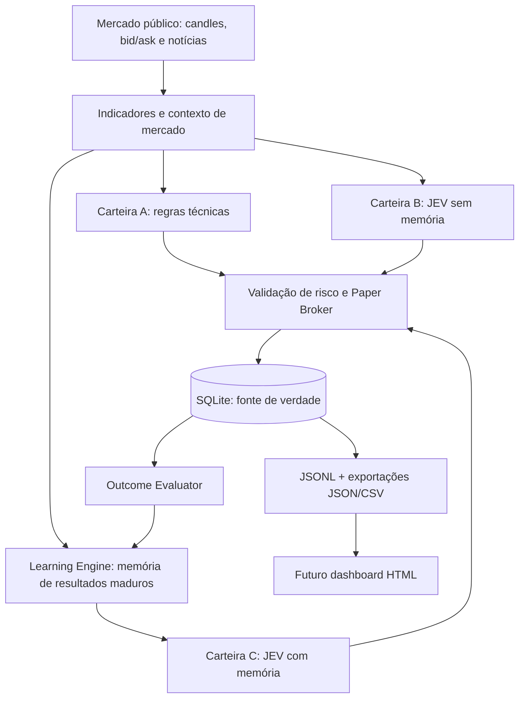

# ai-trade-memory

**Laboratório de negociação simulada de criptomoedas com IA probabilística e aprendizado contínuo.**

> O mercado fornece os dados. O JEV avalia as decisões. O nosso motor de memória aprende com os resultados.

**Status:** 🧪 POC V1 em planejamento/implementação · **Linguagem:** Python 3.11+ · **Modo:** `PAPER_ONLY`

## Visão geral

O **ai-trade-memory** é uma prova de conceito (POC) para investigar se um motor próprio de aprendizado contínuo pode melhorar decisões de negociação de criptomoedas.

O sistema observa **dados reais de mercado**, calcula indicadores técnicos, coleta notícias e consulta o **JEV 1.13**, por meio do **OpenRouter**, para avaliar as ações `BUY`, `SELL` ou `HOLD`. As ordens e carteiras são **100% virtuais**: nenhum dinheiro é negociado em corretoras.

Mais do que simular lucro, a POC busca responder:

1. Uma estratégia com JEV supera uma estratégia baseada somente em indicadores?
2. Fornecer ao JEV o histórico estruturado de erros e acertos melhora suas decisões?
3. A melhoria, se existir, compensa o **custo real** das chamadas ao OpenRouter?

**Importante:** o JEV **não é retreinado** pelo projeto. O aprendizado acontece em um componente Python próprio, que avalia decisões passadas, consolida padrões estatísticos e fornece esse contexto nas próximas chamadas ao modelo.

## Como o experimento funciona

Três estratégias independentes acompanham o mesmo mercado e começam, cada uma, com **100 USDT fictícios**:

| Carteira | Identificador | Estratégia | O que mede |
| --- | --- | --- | --- |
| **A** | `BASELINE_TECHNICAL` | Indicadores e regras fixas, sem IA | Referência quantitativa |
| **B** | `JEV_STATIC` | Indicadores, notícias e JEV, sem memória | Contribuição do JEV |
| **C** | `JEV_LEARNING` | Mesmo JEV + contexto do Learning Engine | Contribuição do aprendizado |

Cada carteira tem saldo, posições, ordens e resultados próprios. **Não** são 300 USDT em uma carteira única: são três cenários comparativos com 100 USDT cada.

### Ciclo operacional



A cada **candle fechado de 15 minutos**, o serviço atualiza os dados e avalia as estratégias. A tendência também considera candles de **1 hora**. Cotações públicas podem ser consultadas entre ciclos para monitorar stops e posições abertas.

Todas as simulações são **Spot, long-only**: `BUY` abre uma posição em BTC; `SELL` encerra a posição existente; `HOLD` não modifica a carteira. Não há short, futuros ou alavancagem.

## Aprendizado contínuo: o diferencial

O **Learning Engine** é independente do JEV. Ele registra o cenário de cada decisão e, quando há dados posteriores suficientes, avalia seu resultado.

- **Memória contextual:** combina regime de mercado, faixas de RSI, volume, volatilidade e situação da carteira.
- **Resultados amadurecidos:** avalia horizontes de **4 e 16 candles**; decisões recentes não entram prematuramente na memória.
- **Comparação contrafactual:** verifica oportunidades não executadas (`HOLD`) sem lançar negociações fictícias na carteira.
- **Estatísticas rastreáveis:** amostras, taxas de acerto, retorno líquido médio, incerteza e período observado.
- **Contexto compacto:** envia ao JEV da carteira C somente os padrões relevantes e suficientemente amostrados.

A V1 usa **aprendizado estatístico e contextual**, não redes neurais nem ajuste automático dos pesos do JEV. Os parâmetros de risco e os limiares da estratégia permanecem fixos durante a comparação. Uma perda isolada não é automaticamente tratada como erro do modelo.

Para evitar conclusões artificiais, somente informações efetivamente disponíveis **antes de cada decisão** poderão influenciá-la (*sem look-ahead*). A POC não pressupõe que as probabilidades do JEV sejam probabilidades calibradas de lucro.

## Configuração inicial da POC

| Parâmetro | Valor inicial |
| --- | --- |
| Mercado | `BTC/USDT` (Spot) |
| Capital | `100 USDT` por carteira |
| Intervalo principal | `15m` |
| Confirmação de tendência | `1h` |
| Indicadores | RSI, MACD, EMA, ATR e volume relativo |
| Alocação máxima por compra | 20% do capital disponível, respeitando o motor de risco |
| Stop-loss / take-profit | 1,5% / 3,0% (valores experimentais) |
| Taxa simulada | 0,10% por lado |
| Slippage simulado | 0,05% por lado |
| Modelo | `typesafe/jev-1.13` via OpenRouter |
| Probabilidade mínima da ação | 0,65, com margem mínima de 0,10 sobre a segunda opção |
| Memória | Janela móvel de 60 dias; padrões com amostragem mínima |
| Persistência | SQLite + eventos JSONL + exportações JSON/CSV |

Esses valores são **hipóteses iniciais de pesquisa**, não parâmetros otimizados nem recomendações de investimento. A especificação técnica completa será adicionada em `docs/SPEC.md`.

## Arquitetura Python

O projeto está planejado como um serviço modular, sem frontend e sem dependências de infraestrutura desnecessárias:

```text
ai-trade-memory/
├── AGENTS.md                 # Orientações para agentes de programação
├── README.md
├── pyproject.toml
├── .env.example
├── config/
│   └── default.yaml
├── docs/
│   └── SPEC.md               # Especificação técnica completa
├── src/
│   └── poc/
│       ├── market/           # Preços, candles e indicadores
│       ├── news/             # Coleta de notícias e disponibilidade temporal
│       ├── decision/         # Estratégia base e integração JEV/OpenRouter
│       ├── learning/         # Resultados, memória e padrões
│       ├── simulation/       # Broker virtual, carteiras e risco
│       ├── infra/            # SQLite, eventos e agendamento
│       └── reporting/        # Métricas e exportações
├── tests/
├── deploy/                   # Configuração systemd (prevista)
└── data/                     # Gerado em execução; ignorado pelo Git
    ├── poc.sqlite3
    ├── logs/YYYY-MM-DD/events.jsonl
    └── exports/
        ├── dashboard-latest.json
        ├── decisions.csv
        ├── fills.csv
        └── ai_usage.csv
```

**Tecnologias previstas:** Python 3.11+, `asyncio`, `httpx`, Pydantic, SQLite, pandas/NumPy, biblioteca de indicadores técnicos, `pytest` e `ruff`.

O banco **SQLite é a fonte de verdade**. Os arquivos JSONL e JSON/CSV são derivados dos registros persistidos e podem ser reconstruídos. Isso prepara o projeto para um dashboard HTML simples, sem criar servidor web na V1.

## Integrações externas

| Serviço | Uso | Segurança |
| --- | --- | --- |
| **Binance Public Market Data** | Candles e preços públicos | Apenas leitura, sem credenciais de exchange |
| **Fontes RSS** | Notícias e contexto temporal | Guardar publicação e primeiro momento de coleta |
| **OpenRouter / JEV** | Classificação probabilística estruturada | Chave em variável de ambiente, nunca nos logs |

A integração do JEV usa a **Decisions API**, e não o endpoint de chat:

```text
POST https://openrouter.ai/api/alpha/decisions
Model: typesafe/jev-1.13
Authorization: Bearer $OPENROUTER_API_KEY
```

O sistema registra `usage.cost`, tokens, latência, modelo e status de cada chamada quando disponibilizados. Custos **reais em USD** do OpenRouter ficam separados do saldo **virtual em USDT**. Chamadas compartilhadas entre B e C não devem ser cobradas duas vezes na contabilidade.

## Como executar (interface prevista)

> **Atenção:** os comandos abaixo fazem parte do contrato de implementação da POC. Eles estarão disponíveis **após o código Python ser implementado** conforme `docs/SPEC.md`; este README, sozinho, não disponibiliza um bot executável.

Preparação do ambiente:

```bash
python3 -m venv .venv
source .venv/bin/activate
python -m pip install -e ".[dev]"
cp .env.example .env
```

No arquivo `.env`, configurar localmente `OPENROUTER_API_KEY` para as consultas reais ao JEV. Nunca versionar credenciais.

Comandos previstos para execução e manutenção:

```bash
# Inicializar banco e validar componentes offline
python -m poc init-db --config config/default.yaml
python -m poc smoke-offline --config config/default.yaml

# Testar UMA chamada ao OpenRouter (requer chave)
python -m poc smoke-openrouter --config config/default.yaml

# Coletar histórico de mercado sem criar trades retroativos
python -m poc backfill --config config/default.yaml --days 7

# Iniciar a POC continuamente
python -m poc run --config config/default.yaml

# Consultar situação e gerar dados para análise
python -m poc status --config config/default.yaml
python -m poc report --config config/default.yaml --format json
python -m poc export --config config/default.yaml --format all
```

Em Linux, a execução contínua poderá ser gerenciada por **systemd**, com retomada automática a partir do SQLite. Reiniciar o processo **não** reinicializa o capital nem permite duplicar operações. Se o serviço ficar offline, ele recompõe dados e avaliações pendentes, mas não executa ordens retroativas como se tivesse estado online.

## Logs, métricas e futuro dashboard

O projeto será desenvolvido com observabilidade desde o início:

- **Decisões:** features, notícias disponíveis, contexto da memória, probabilidades, ação proposta, ação validada, motivos de rejeição.
- **Negociações virtuais:** ordens, preço de preenchimento, taxas, slippage, quantidade e PnL realizado.
- **Carteiras:** USDT disponível, BTC em posição, patrimônio, retorno, exposição e drawdown.
- **Aprendizado:** resultados amadurecidos, padrões, tamanho da amostra e versões da memória.
- **Uso da IA:** chamadas, latência, tokens, falhas, custo efetivo em USD e custo desconhecido quando não houver informação de cobrança.
- **Operação:** heartbeat, falhas de mercado, atrasos de candles, reinicializações e recuperação.

As principais comparações são **B − A** (valor adicionado pelo JEV) e **C − B** (valor adicionado pelo Learning Engine). O relatório também avaliará resultado líquido simulado, risco e custo das chamadas da IA.

Uma POC que termina com mais de 100 USDT **não comprova, por si só, vantagem estatística nem rentabilidade futura**. O objetivo é coletar evidências reproduzíveis, inclusive quando o desempenho for negativo.

O futuro frontend em HTML poderá consumir `data/exports/dashboard-latest.json` e os arquivos CSV. **Não há frontend no escopo da V1.**

## Garantias e limitações

- **Nenhuma ordem real:** sem depósitos, saques, credenciais de corretora ou rotas privadas para enviar ordens.
- **Falha segura:** sem preços válidos ou resposta confiável do JEV, não abrir posições por inferência.
- **Risco acima da IA:** saldo, stop-loss, take-profit, limites e estado da posição prevalecem sobre qualquer sugestão do modelo.
- **Auditoria:** configurações, decisões, resultados e custos devem ser reproduzíveis e rastreáveis.
- **Pesquisa, não aconselhamento:** o projeto é experimental e não representa promessa de ganhos financeiros.

## Roadmap da V1

- [ ] Estrutura Python, configuração, banco, broker virtual e testes offline.
- [ ] Coleta pública de mercado, indicadores e execução contínua sem duplicações.
- [ ] Integração OpenRouter/JEV, carteiras A/B/C e apuração de custos reais da IA.
- [ ] Outcome Evaluator, rótulos amadurecidos e Learning Engine contextual.
- [ ] Notícias, relatórios, JSONL/CSV/JSON, operação com systemd e testes de aceite.

**Documentação de implementação (a publicar):** `docs/SPEC.md` definirá as regras e invariantes obrigatórias; `AGENTS.md` orientará os agentes de programação. Em caso de divergência, a especificação técnica será a referência para implementação.

## Referências

- [TypeSafe AI — JEV](https://docs.typesafe.ai/introduction)
- [OpenRouter — JEV 1.13](https://openrouter.ai/typesafe/jev-1.13)
- [OpenRouter — Decisions API](https://openrouter.ai/docs/api/api-reference/alphadecisions/submit-a-decisions-request)
- [Binance — dados públicos de mercado](https://github.com/binance/binance-spot-api-docs/blob/master/faqs/market_data_only.md)

---

*ai-trade-memory — decisões probabilísticas, memória própria e evidência mensurável.*