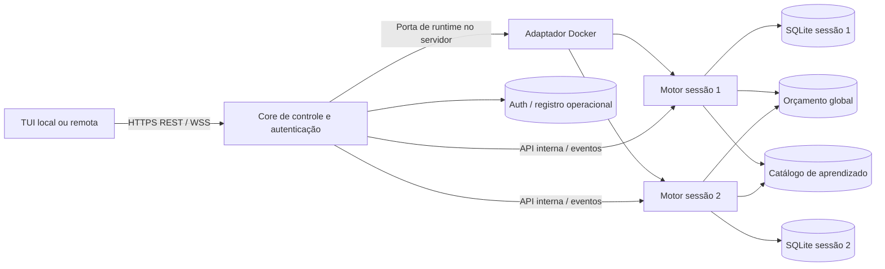

# Arquitetura da POC V1 completa

**D012/D050–D056 · SPEC 1.54.** Fronteiras preservadas; implementação/evidências no status e novos perfis planejados em P00–P09.
[Plano](PLANO_DESENVOLVIMENTO_V1.md) · [Escopo](ESCOPO_POC_V1.md).

## Fronteiras

Um projeto Python: domínio financeiro/risco/técnica/aprendizado sem HTTP/SQLite/interface; aplicação/casos de uso dependem de portas; adaptadores implementam mercado/contexto/JEV/persistência/runtime/API. Bootstrap conecta implementações. [Hexagonal](https://alistair.cockburn.us/hexagonal-architecture).

Engine reúne módulos no mesmo processo e mantém risco ativo durante inferência. CLI/API acionam aplicação comum; TUI é cliente REST/WS. Não criar serviço por indicador.

## Topologia

Imagem comum/Compose, um motor/volume por sessão, catálogo inicial trend_15m_v1 e par Spot USDT configurável. A/B/C com 100 USDT cada, sem saldos compartilhados.

Controle expõe endpoint remoto único; motores permanecem privados. Lifecycle Docker é server-side, com argumentos/identidades validados; TUI não acessa daemon/DB. Registro não substitui ledger. Documentar os privilégios necessários do runtime no host.

## Protocolos e estado

REST para auth/perfis/config/lifecycle/consultas/dataset; WS para processamento observável/cotações/decisões/saúde/eventos. Snapshot consistente/watermark, cursor/replay/dedupe/resync e filas limitadas. Eventos financeiros duráveis distintos de ticks efêmeros.

HTTPS/WSS remoto, senha/TOTP 2FA, tokens opacos expiráveis/revogáveis/refresh rotativo/escopos. Proprietário inicial local; segredos fora de URL/log/imagem. FastAPI/Uvicorn e Textual são escolhas iniciais. [Contrato](SPEC.md).

Sair/desconectar/expirar token não para bot. Nova/restaurar distintas, run_id/config fixos, sem reset/retrotrade; CLI alternativa.

## Persistência e aprendizado

Fill/ledger/saldo/eventos num commit financeiro; JSONL reconstruível. Sem I/O externo prolongando transação, com risco/quote revalidados.

SQLite por sessão é autoridade financeira. budget.sqlite global reserva tentativas/custo; control.sqlite guarda auth/registro/comandos; catalog.sqlite é read model de observações maduras, sem saldos. Não presumir commit entre bancos; outbox/reconciliação idempotentes.

Memória local por símbolo; catálogo publica novas fontes e transferência validada alimenta só C conforme [contrato](TRANSFERENCIA_APRENDIZADO.md). Origem estrangeira nunca conta como local, nem ganha disponibilidade histórica retroativa.

## Operação

Extensão D056: [perfis cadastráveis](PLANO_PERFIS_ESTRATEGIA.md) reutilizam o
controle/SQLite e a imagem comum. Domínio define famílias e parâmetros; aplicação
valida/registra/resolve perfis; adaptadores expõem CLI/REST/TUI e persistência.
Revisões ficam em tabelas no control.sqlite3 existente, sem novo serviço/ledger.
Cada sessão conserva snapshot completo imutável; restauração não depende da
versão atual do catálogo. Cadastro não carrega código dinâmico nem parâmetros
globais de segurança/custo. Swing/scalping/day trade planejados; hold posterior.

Mesmo host/volumes locais/WAL: [SQLite](https://sqlite.org/wal.html). Sem cluster/distribuição de bancos. Compose restart unless-stopped, SIGTERM/grace, heartbeat, backup consistente/restore testado; CLI/systemd sem supervisor duplicado.

D059/SPEC 1.57: perfis cadastráveis definem orçamento JEV próprio por bot/sessão. `ai` contém chamadas/dia, habilitação do limite financeiro e valor USD/dia, editáveis antes da partida. Snapshot imutável por sessão; contadores/recibos transacionais por run_id no SQLite operacional compartilhado. Defaults de 240/US$ 0,05 não são tetos globais. Reuso de classificação/chamada B-C não duplica despesa; recusa por orçamento de um pagador não bloqueia outro. Total agregado apenas como relatório. D053 mantém somente compatibilidade das sessões antigas; falta de orçamento gera HOLD B/C com risco ativo.

Hospedagem usa reverse proxy TLS e portas internas privadas. Rede/volumes/restart: [Docker networking](https://docs.docker.com/compose/how-tos/networking/), [volumes](https://docs.docker.com/engine/storage/volumes/), [restart](https://docs.docker.com/engine/containers/start-containers-automatically/). Leituras não comprovam runtime.

Implementar Marcos 1–5, E06–E11; testar quota concorrente, auth/reconexão, transferência, crash/backup e operação no período de amostragem definido pelo usuário (D054), sem mínimo de 24h ou espera para atualizar. Preservar histórico e identificar versões/intervalos nas análises. Sem frontend HTML ou operação financeira real.
