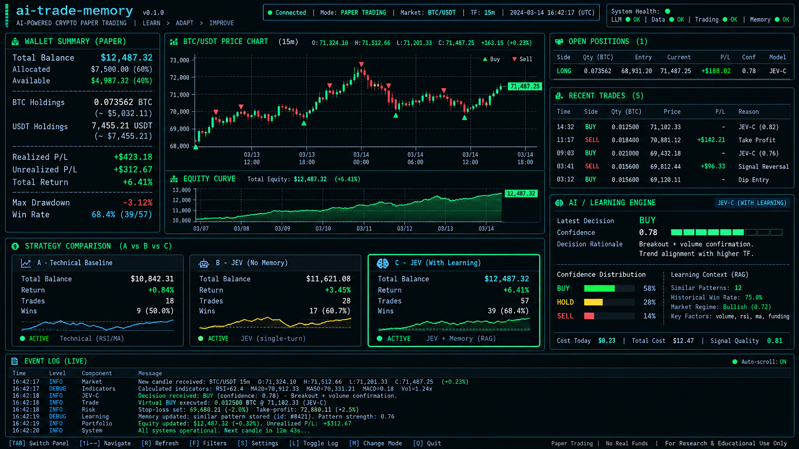

# TUI V1 — contrato de desenvolvimento

**D059/SPEC 1.57:** limites JEV são editáveis no perfil/criação e aplicados
por bot/sessão (SESSION). Total agregado é somente relatório; contadores, custos
físicos e recibos permanecem transacionais e não são zerados na retomada.
Templates `.3`; exemplos em [GUIA_PERFIS_BOTS.md](GUIA_PERFIS_BOTS.md).

**D051/D052 · SPEC 1.50/15.4.** Textual local/remota implementada após núcleo/transferência/API. Dashboard ampliado em 14/10/2026 somente no cliente, sem alteração do core.
[Plano E10](PLANO_DESENVOLVIMENTO_V1.md) · [Arquitetura](ARQUITETURA.md).

## Referência

Imagem intacta; fundo escuro/bordas/ciano/verde/teclado adaptados ao terminal. Valores/mecanismos ilustrados não substituem SPEC, capital ou aprendizado.

## Fluxos

**Implementado D057:** botão/atalho P para perfis, templates completos, seleção
de estilo/família, edição JSON dos parâmetros/instruções, schema, validação/prévia,
publicação e arquivo de versões. Sessão nova escolhe revisão/hash e ajusta valores;
intervalos exibidos vêm do snapshot. Botão Parar preserva histórico. Reabrir a TUI
para carregar a versão nova. [Guia](GUIA_PERFIS_BOTS.md).
1. Endereço do core, login/senha/2FA e conexão HTTPS/WSS remota.
2. Listar/selecionar sessões e saúde; nova ou restaurar run_id.
3. Nova: perfil/par/template/ajustes permitidos/dataset opcional/transferência antes de iniciar; backend valida/importa/persiste.
4. Restaurar: estado/configuração/capital/posições/memória/travas/ciclos; sem reset/reimport/retrotrade.
5. Dashboard/atalhos/filtros/import-export/ajuda, com sair/logout mantendo motores.

REST para comandos/consultas/dataset; WS para eventos/etapas observáveis/preços/decisões. Lifecycle Docker fica no servidor. TUI sem DB/broker/daemon, edição intrassessão ou modo real.

## Dashboard

| Área | Conteúdo |
| --- | --- |
| Cabeçalho | Sessão/par/perfil/intervalo, PAPER ONLY, conexão/saúde/horário. |
| Esquerda | Carteira: patrimônio/caixa/ativo/PnL/retorno/drawdown/trades fechados. |
| Centro | Candles/preço e curvas A/B/C por carteira. |
| Direita | Posições/fills, proposta/validação/execução/motivo, memória/custo. |
| Comparação | A técnica/B sem memória/C com memória local e/ou transferida. |
| Aprendizado | Fontes/destino/local-transferida/contagens/janela/validação/estado e motivo. |
| Rodapé | Processamento observável/eventos/cursor/filtros/atalhos. |

### Dashboard implementado em 14/10/2026

- Candles no topo em toda a largura. Logo abaixo, Carteiras A/B/C e Patrimônio
  A/B/C lado a lado na mesma linha; em terminais menores, os dois painéis são
  empilhados. Resumo das decisões e fontes aparecem em seguida.
- Marcadores ● para o instante de avaliações registradas; ▲/▼ somente para fills
  confirmados. Faixas A/B/C preservam identificação em operações coincidentes;
  ◆ indica coincidência de compra/venda na mesma célula. Clique nas faixas ou
  use o seletor de ciclos para consultar o resumo correspondente.
- Resumo por carteira distingue proposta, execução e motivo registrado, com
  probabilidades da ação, confiança JEV quando fornecida e estado da memória C.
  Carteira ainda não concluída fica pendente; não é misturada com ciclo anterior.
- RSI, tendência de 1h, MACD histograma, volume relativo, EMAs e ATR vêm do
  estado salvo da decisão selecionada, sem recalcular regras ou indicadores.
- Notícias e Polymarket mostram o último registro recebido pela API,
  independentemente do ciclo selecionado, conforme solicitação do usuário.
  Notícia traz título/trecho/origem/datas; Polymarket, pergunta/resultado,
  probabilidade implícita/spread/deltas/prazo quando disponíveis. Separar horário
  dos metadados e livro/preço. Direção/confiança da classificação são identificadas.
- Se a fonte ficar sem fator atual, reter o último recebido nesta conexão com
  aviso REGISTRO ANTERIOR; na abertura, o histórico recente das decisões pode
  fornecer esse registro quando exposto pela API. Não consultar SQLite/cache do
  servidor na TUI. Sem registro recebido, informar a ausência.
- Troca de sessão/logout limpa seleção, marcadores e retenção das fontes.
  Acompanhar último ciclo é o padrão; selecionar histórico preserva a escolha
  enquanto o ciclo estiver entre os registros recentes disponíveis.

A API atual entrega até 20 decisões e 20 fills recentes; os marcadores não
representam o histórico completo. Evento após o último candle fechado é listado
separadamente até existir candle correspondente, sem antecipar ou retroagir sua
posição. Perguntas/contexto não equivalem a justificativa causal do JEV; o cliente
traduz motivos registrados sem gerar explicações ou fazer novas inferências.

Aplicação: sair/reabrir apenas a TUI. Motor, controle, bancos e observação de 24h
não precisam ser reiniciados para essa alteração de apresentação.

Layout adaptável/abas para terminal menor; testar legibilidade e resize. Não prometer reprodução pixel a pixel.

## Dados e comportamento

- 100 USDT por carteira; Decimal/string do motor, USD/custo IA unknown separado.
- Símbolo/quantidades dinâmicos, sem valores da imagem.
- Local >=30/50, 60d/três padrões totais; transferência com gates e origem explícita, inclusive VALIDATING/SUSPENDED.
- Confiança JEV, probabilidade de ação e taxa histórica são conceitos diferentes; BUY sugerido não é fill.
- Desconexão/estado antigo explícitos; snapshot/watermark/cursor/dedupe/replay.
- GET/renderização não chamam JEV/operam. Processo continua sem cliente.
- Tokens/segredos fora de logs; etapas do bot não são raciocínio interno do modelo.
- Ajuda usa [estratégias](ESTRATEGIAS.md)/SPEC, sem expor todo detalhe interno como configuração.

Testar login/2FA/read-only, criação/config/sem dataset/restore, duas sessões/pares, gráficos/resize, vazio/degradado, WS perdido/cursor, transferência e saída. [Textual](https://textual.textualize.io/) e [testes](https://textual.textualize.io/guide/testing/) sustentam escolha, não comprovam implementação.
