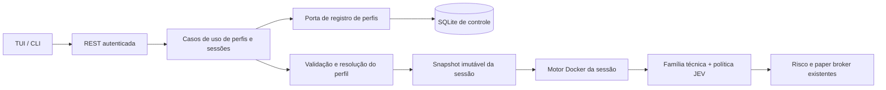

# Plano de implementação dos perfis de estratégia

**Plano 1 · 14/10/2026 · D056 · extensão da SPEC 1.54.**
**Atualização D057:** cadastro genérico, motor parametrizado, protocolos V2 e
TUI implementados. P00–P08 com testes locais; integração real/latência/eficácia e
escolha do próximo bot seguem a observação P09. ETH parada a pedido do usuário,
sem novo bot automático. [Guia de uso](GUIA_PERFIS_BOTS.md). O texto a seguir
preserva o plano original; estados atuais estão no status.

**Atualização D060/SPEC 1.58:** validação SCALPING aceita prazo de decisão de
até 15s. O novo teste ZEC usa 15s/timeout IA 6s, mantendo 1m/5m e proteção.
Valores 8s/6s abaixo registram a proposta/preset original, sem migrar sessões.

[Pesquisa e fontes](PESQUISA_PERFIS_ESTRATEGIA.md) ·
[Template completo](templates/perfis/perfil.template.yaml) ·
[Swing](templates/perfis/swing_4h_v1.yaml) ·
[Scalping](templates/perfis/scalping_1m_v1.yaml) ·
[Day trade](templates/perfis/daytrade_15m_v1.yaml) ·
[Estado real](STATUS_DESENVOLVIMENTO.md).

## 1. Entrega e sequência combinadas

1. Observar o core atual com `trend_15m_v1`, no período escolhido pelo usuário.
   Revisar mercado/JEV/fontes/custos, ledger, retomada, memória e pequenas falhas.
2. Corrigir os problemas encontrados sem apagar evidências; registrar versões.
3. Executar P00–P09 abaixo para cadastrar, configurar e operar perfis novos.
4. Homologar os fluxos do perfil escolhido e abrir sessão dedicada para observar
   aproximadamente um mês, com parâmetros e versões identificados.

Escopo novo: **swing, scalping e day trade**, mais preservação integral do perfil
legado. **Hold fica para uma segunda etapa**, sem template operacional nesta entrega.
Não implementar negociação real, microserviços por indicador, linguagem de scripts,
otimizador de parâmetros ou uma plataforma de backtesting para concluir esse plano.

Pedido aprovado: perfis cadastráveis, templates completos e instruções para o JEV.
Os números dos novos presets são **hipóteses técnicas propostas para paper trading**,
não parâmetros calibrados nem lucro esperado. A pesquisa sustenta conceitos;
não atribuir os nossos thresholds às fontes. Não iniciar sua implementação só
porque este plano foi escrito; o usuário definiu primeiro a revisão do core.

## 2. Diferença entre os conceitos

| Conceito | Exemplo | Responsabilidade |
| --- | --- | --- |
| Estilo | Swing, scalping, day trade | Horizonte e modo de operação. |
| Família implementada | Rompimento comprado, cruzamento de EMAs | Código determinístico e contexto de setup. |
| Perfil cadastrado | `swing_4h_v1`, uma variação cadastrada pelo usuário | Família, parâmetros, horários e instruções versionados. |
| Variante | A técnica, B JEV, C JEV com memória | Método comparado dentro do mesmo perfil. |
| Sessão persistida | `swing-eth-01` | Snapshot imutável, moeda, banco/container e trio próprios. |
| Janela diária | Dia UTC de um perfil intradiário | Horário de entrada/encerramento; não encerra o banco da sessão. |

Cadastrar outro perfil de uma família suportada não exige novo Dockerfile ou
codificação. Inventar uma família de sinais ainda sem implementação exige código
e testes: texto livre no template não cria um algoritmo. A/B/C recebem o mesmo
perfil, relógio, oportunidades admitidas, custos e regras duras; C acrescenta
somente memória compatível. Cada carteira continua com 100 USDT virtuais.

## 3. O que existe e precisa ser generalizado

Inspeção do checkout em 14/10/2026; os caminhos abaixo são reais.

| Área | Dependência encontrada | Mudança necessária |
| --- | --- | --- |
| `application/sessions.py`, `application/control.py` | `PROFILE_ID`, template e versão únicos | Resolver perfil/versionamento pelo registro, mantendo restauração legada. |
| `config.py`, CLI e `inbound/control_api.py` | Literais `15m`, `1h`, perfil e labels 4/16 | Schema V2 discriminado e validação de capabilities. |
| `domain/candles.py`, `outbound/market.py` | Mapa de intervalos e streams 15m/1h | Intervalos UTC fixos permitidos e streams derivados do perfil. |
| `application/engine.py`, `orchestrator.py`, `inbound/service.py` | Warmup/backfill, ciclo e duração em 900s | Agenda, idade e duração resolvidas; relógio independente da IA. |
| `domain/features.py`, `technical.py` | `trend_1h`, retornos 1/4/16 e baseline único | Features temporais neutras e registro de famílias determinísticas. |
| `domain/jev.py`, `application/ai_policy.py` | Perguntas genéricas sem contrato completo de estilo | Bloco de estratégia resolvido, regras duras e instruções fixadas. |
| `domain/factors.py`, `application/context.py`, `outbound/context_service.py` | Nome do perfil e janela `max_holding_candles * 900` | Classificação/cache compatíveis com estilo, parâmetros semânticos e duração real. |
| `application/learning.py`, `domain/dataset.py`, transferência | Perfil/intervalo e validação temporal fixos | Protocolo/dataset V2; memória separada por perfil e horizonte em segundos. |
| `outbound/files.py`, TUI/gráficos/presenters | Consulta e títulos 15m/1h | Snapshot traz intervalos/estilo/agenda; interface não calcula estratégia. |

Não substituir todo `900`/`3600` cegamente: reconexão WebSocket, TTLs e orçamento
diário são contratos distintos. O perfil antigo deve continuar reproduzindo seus
cálculos, incluindo IDs, hash, maturação e contagem de candles, sem reinterpretar
o histórico com a semântica nova.

## 4. Arquitetura proposta, dentro da arquitetura existente

- **Domínio:** `ProfileDefinition`, intervalos, agenda, schemas de parâmetros,
  descrição de setup, sinais e invariantes. Sem SQLite/HTTP/Docker.
- **Aplicação:** `RegisterProfile`, `ValidateProfile`, `PublishProfile`,
  `ResolveSessionProfile` e agenda de decisões/saídas. Usar portas para registro,
  relógio, mercado, orçamento e unidade de trabalho existentes.
- **Porta nova:** `ProfileRepositoryPort`: obter versão, listar, criar revisão,
  publicar/arquivar com auditoria. `StrategyRegistry` associa IDs conhecidos a
  implementações compiladas; não faz import dinâmico vindo do YAML.
- **Adaptadores:** SQLite de controle, CLI, REST e formulários TUI. Bootstrap
  continua sendo a raiz de composição. Uma imagem comum, um motor por sessão.
- **Sem nova autoridade financeira:** o catálogo guarda definições e eventos
  administrativos, nunca saldo, posição ou aprendizado da sessão.

Persistir revisões em novas tabelas do **`data/control/control.sqlite3` existente**:
`strategy_profile_versions` e `strategy_profile_events`, com chave ID/versão,
JSON canônico, hash, estado, ator e timestamps. Versão publicada é imutável.
Cada sessão copia a definição completa, instruções, parâmetros originais/overrides,
versões de família/features/prompt e configuração resolvida para seu próprio banco.

O motor restaura essa cópia; não consulta a versão mais recente do catálogo para
reconfigurar uma sessão. Arquivar um perfil impede novas seleções, mas não impede
retomar sessões antigas. Exigir que a imagem saiba executar a versão da família
fixada no snapshot. Catálogo indisponível não transforma restauração em sessão nova.

Compatibilidade exige um leitor explícito de Config V1: verificar o hash contra o
JSON canônico original, antes de qualquer adaptação em memória. Acrescentar campos
com defaults ao modelo e reserializar não preserva automaticamente o hash. Manter
contratos de labels/features/equivalência V1 e IDs antigos, enquanto snapshots V2
registram o schema novo. Criar teste de regressão com registro anterior à mudança.

## 5. Cadastro, revisão e template completo

Fluxo: **escolher um preset → duplicar template completo → alterar → validar →
cadastrar revisão → publicar para paper → selecionar na criação de sessão**.

| Estado | Uso |
| --- | --- |
| `DRAFT` | Pode ser cadastrado/editado como nova revisão; não inicia motor. |
| `READY_FOR_PAPER` | Schema, família, parâmetros e verificações suportados; selecionável. |
| `ARCHIVED` | Preserva versões e sessões; indisponível para novas sessões. |

Publicar exige proprietário global/manage/2FA na API ou operador local, sem novo
fluxo de autenticação. Repetições de cadastro/publicação são idempotentes. Colisão
de ID/versão com conteúdo diferente é erro; não sobrescrever. Perfis built-in são
versionados e protegidos; uma customização usa ID próprio ou nova revisão.

Os quatro YAMLs em `docs/templates/perfis/` são **documentos completos de contrato
futuro**, não configs aceitas pelo CLI atual. Todos contêm os mesmos caminhos:
identidade, mercado, indicadores, gates, risco, custos, IA, agenda, aprendizado,
notícias/Polymarket e referências da plataforma. Não há `extends`, merge oculto
ou chave privada. Campos sem aplicação usam `null` com regra explícita.

### Tipos, unidades e edição

- Dinheiro, quantidades, spread, custo e percentuais financeiros: strings decimais
  finitas. `"0.10"` significa 0,10%; divisão por 100 dentro do domínio.
- Contagens/segundos/candles: inteiros estritos. Probabilidades/indicadores:
  números finitos nos intervalos definidos. Booleanos estritos, sem coerção de texto.
- `null` significa desabilitado/não aplicável apenas nos campos documentados.
  Nunca converter ausência de dado em neutro, zero ou parâmetro permitido.
- Objeto com propriedades desconhecidas é rejeitado; parâmetros de outra família
  não são aceitos por coincidência de nome. Importação limitada por tamanho e YAML
  seguro, sem tags executáveis/aliases ilimitados, caminhos ou endpoints arbitrários.
- Campos operacionais globais aparecem como **referências somente leitura**.
  O perfil não muda orçamento global, segredos, endpoints públicos allowlisted,
  storage, autenticação, runtime, paper-only, capital ou variantes.
- `session_defaults.symbol` e dataset são defaults da nova sessão, não identidade
  fixa do estilo. Seleção efetiva sempre valida metadados públicos e compatibilidade.

### Cobertura dos parâmetros existentes

| Grupo atual | Destinação no template completo |
| --- | --- |
| `app` | Frescor/poll/instância em `parameters.app`; modo/timezone/localização em `platform_bindings`. |
| `market` | Intervalos/provider/warmup/min_notional em `parameters.market`; símbolo em `session_defaults`; URL em referência pública da plataforma. |
| `portfolios` | Trio e capital fixos em `platform_bindings.portfolios`. |
| `strategy` e `technical` | Mesmos controles em `parameters.strategy`; novos controles de família explícitos. |
| `simulation`, `indicators`, `news`, `polymarket` | Todos os parâmetros explícitos nos grupos homônimos. URLs/modelo/providers protegidos. |
| `ai` | Modelo/provider/endpoint/teto de chamadas por referência protegida; timeout/retries/prompt em `parameters.ai`. Teto legado não vira subquota editável. |
| `ai.max_observed_cost_usd_per_day` | Campo legado; V2 usa referência à política global D053, sem override por perfil. |
| `learning` e `transfer` | Mesmos mínimos/limites + horizontes, janela de cotação e compatibilidade explícitos. Dataset inicial em `session_defaults`. |
| `storage` | Referência somente leitura a caminhos geridos por run_id; não editar no cadastro remoto. |
| Novos controles | `parameters.opportunities`, `operation_window`, `execution_quality`, `jev_instructions`. |

Schema e TUI devem informar tipo, unidade, descrição, faixa e condição de aplicação
de **cada folha**, gerados do mesmo modelo Pydantic. Estes documentos não criam
um segundo validador de produção. Prévia mostra parâmetros efetivos, campos
protegidos, hashes, duração derivada, demanda de IA e diferenças para o preset.

## 6. Presets iniciais propostos

| Campo | Day trade | Swing | Scalping |
| --- | --- | --- | --- |
| ID | `daytrade_15m_v1` | `swing_4h_v1` | `scalping_1m_v1` |
| Família | `breakout_long_v1` | `breakout_long_v1` | `ema_cross_long_v1` |
| Candle / tendência | 15m / 1h | 4h / 1d | 1m / 5m |
| EMAs | 20/50/200 | 20/50/200 | 9/21/50 |
| Janela de rompimento anterior | 8 candles | 20 candles | Não aplicável |
| Buffer acima da máxima | 0,05% | 0,10% | Não aplicável |
| RSI de entrada A / volume relativo mínimo A | 50–70 / 1,20 | 50–70 / 1,20 | 50–68 / 1,30 |
| Stop / take fixos | 1,00% / 2,00% | 4,00% / 8,00% | 0,35% / 1,20% |
| Posição máxima | 32 candles = 8h | 84 candles = 14 dias | 15 candles = 15min |
| Encerramento UTC | 23:55, novas entradas até 23:30 | Sem encerramento diário | 23:59:30, entradas até 23:55 |
| Gatilho de avaliação | Cada candle fechado | Cada candle fechado | Setup local ou posição em qualquer carteira |
| Espaçamento / teto de ciclos UTC | 900s / 96 | 14400s / 6 | 300s / 80 |
| Prazo máximo / timeout IA | 30s / 10s | 90s / 20s | 8s / 6s |
| Cotação com idade máxima | 5s | 30s | 2s |
| Labels / principal | [4,16] / 4 = 1h | [6,42] / 6 = 1 dia | [3,15] / 3 = 3min |
| Janela de bid para label | Até 30s | Até 90s | Até 10s |

Nos três: uma posição por carteira, alocação máxima 20%, trava diária 5%, custos
iniciais atuais (taxa 0,10% e slippage 0,05% por lado), probabilidade mínima 0,65,
margem 0,10 e máximo duas tentativas físicas quando couberem no prazo. Ajustes são
possíveis antes da sessão e permanecem sujeitos à validação do contrato.

### Regras determinísticas e regras comuns

Definir `trend_direction` pelo alinhamento EMA curta > EMA média nos candles de
tendência **fechados**. A usa ainda alinhamento das três EMAs no candle de decisão,
MACD positivo, RSI dentro da faixa e volume relativo mínimo do preset.

- **Rompimento comprado:** `level[t] = max(high[t-N:t])`, excluindo o candle t.
  Setup estrutural válido quando `close[t] > level[t] * (1 + buffer_pct/100)`.
  A exige também as confirmações acima. Mesmo algoritmo serve day trade e swing;
  tempo, parâmetros e instruções lhes dão contratos diferentes.
- **Cruzamento comprado:** EMA curta[t−1] <= média[t−1] e curta[t] > média[t].
  A exige também média > longa e as confirmações de momentum/volume do preset.
  Não repetir entrada por continuar acima da média; cooldown de reentrada explícito.
- **A em posição:** vender se curta < média ou MACD histograma < 0. Saída por RSI
  acima de 75 habilitada em day trade/scalping, desabilitada no swing inicialmente.
  Sem sinal, HOLD. Stops/take/duração/agenda/trava são saídas do motor para A/B/C.
- **B/C:** JEV avalia BUY/SELL/HOLD considerando objetivo/horizonte, setup, contexto
  e posição próprios; C recebe memória quando compatível. O setup estrutural é
  requisito de nova compra em todos; as confirmações completas de A não obrigam
  JEV a copiar A. Registrar qual regra dura ou fundamento rejeitou uma proposta.

O bloco de instruções da estratégia explica essas distinções. Regras duras não
são texto opcional: o código valida setup, prazo, quantidade, agenda e risco depois
da inferência. JEV não muda stop, capital, timeframe, limiar ou tamanho da posição.

### Agenda e proteção sem depender do JEV

O relógio de proteção acompanha cotações válidas e deadlines, mesmo sem candle,
cliente, orçamento ou IA. Day trade/scalping possuem fechamento programado; a
sessão persistida continua no dia seguinte. Sem cotação na hora do fechamento,
registrar `SESSION_EXIT_PENDING`, manter proteção e bloquear novas entradas até
resolver. Não inventar preço nem supor que a virada UTC liquidou a posição.

O swing pode atravessar vários dias; a trava de perda diária existente continua
valendo e pode encerrar a posição. Não interpretar seu horizonte longo como
autorização para ignorar stop/trava. Posições novas usam prazo em segundos desde
o fill. Adaptador legado preserva sua contagem anterior por buckets de 15m.

Inserir a saída de agenda na precedência existente sem trocar a prioridade das
proteções antigas; quando coincidir com stop/trava/take/duração, registrar somente
o fill e motivo vencedor. Uma pendência de encerramento da sessão bloqueia novas
entradas do trio até resolver, inclusive se o calendário já avançou.

## 7. Scalping, custo e capacidade do JEV

Scalping planejado é **paper de minutos**, não HFT ou execução em milissegundos.
O WebSocket acompanha preços continuamente; features surgem em 1m fechado.
Avaliação local barata não significa uma requisição JEV. Proteger pelo fluxo de
cotações; não esperar a inferência para disparar stop/take/encerramento.

Admissão proposta, persistida e igual para A/B/C:

1. Dados/cotação/relógio/agenda e custo esperado válidos.
2. Se todas estão flat, admitir somente se existe setup estrutural local válido,
   RSI amplo 35–80 e volume relativo >=1,00. Esses filtros são mais amplos que A.
3. Se qualquer carteira tem posição, admitir checkpoints para SELL/HOLD, mesmo sem
   setup novo. Uma carteira flat só compra se seu setup duro continuar válido.
4. Aplicar espaçamento de 300s e máximo 80 ciclos/dia UTC para o trio, persistidos
   contra restart. As saídas de proteção não consomem ciclos nem IA.
5. Candle recusado gera contagem/evento de admissão, sem uma decisão JEV fictícia.
   Divulgar sinais detectados, admitidos, recusados e motivo; o teste avalia esse
   protocolo seletivo, não todos os scalps possíveis no mercado.

Setup recusado por cooldown não fica numa fila para ser negociado depois: só um
novo candle atual, dentro do deadline, pode sustentar outra admissão. A agenda
dependente das posições do trio faz parte do protocolo observado; não apresentar
as diferenças de retorno como um ensaio causal isolado da política de admissão.

| Perfil | Candles/dia | Ciclos admitidos máximos propostos | Chamadas trade se B/C compartilharem / separarem |
| --- | --- | --- | --- |
| Legado 15m | 96 | 96 | 96 / 192 |
| Day trade | 96 | 96, antes de horário/gates | 96 / 192 |
| Swing | 6 | 6 | 6 / 12 |
| Scalping | 1440 | 80 | 80 / 160 |

Valores antes de classificação/retries, sem garantia de uso integral. O orçamento
**global continua até 240 chamadas/dia UTC**. Não multiplicar por perfil, criar
reservas fictícias ou aumentar limites para fazer os presets caberem. Desligar
limite financeiro D053 não desliga o de chamadas. Sessões simultâneas competem
pela mesma capacidade. Se faltar, registrar HOLD afetado e manter risco/A.

Reutilizar D055 para notícias, inclusive comparação compartilhada; nunca coletar
notícia/Poly em cada tick. Notícias até 24h e preços Poly até 10m continuam contexto
auxiliar: não justificam dizer que o bot sabe qual será o próximo movimento de 1m.

### Qualidade de execução

Calcular prévia em Decimal usando ask/bid, quantidade quantizada, taxa e slippage
com as mesmas funções do broker. Novo gate exige ganho líquido-alvo positivo e
razão ganho líquido-alvo/perda estimada no stop >=1,20. É viabilidade de cenário,
não valor esperado/probabilidade de lucro. Não contar spread duas vezes.

Limites iniciais de spread de mercado cripto: 0,20% swing, 0,10% day trade,
0,05% scalping; distintos do spread **Polymarket** em pp. Desvio absoluto do ask
após inferência em relação à referência: 0,50%, 0,10% e 0,02%, respectivamente.
Revalidar antes do fill. Se ultrapassar limite, expirar proposta sem BUY retroativo.
Os parâmetros são gates comuns, não imposição de número mínimo de trades.

Oportunidade de 8s não comporta automaticamente dois timeouts de 6s: usar apenas
as tentativas que caibam no deadline restante. Medir p50/p95/p99 de feature→pedido,
resposta e resposta→cotação/fill. Comparar a latência ponta a ponta ao prazo;
se não atender, ajustar nova versão do perfil ou deixar scalping não publicável,
sem aumentar silenciosamente frescor/prazo. O stream kline não é tick a tick.

## 8. Contrato da IA e contexto externo

Acrescentar ao state `strategy_context`: ID/versão, estilo/família, regra de setup,
intervalos, janela de posição, agenda/tempo restante, parâmetros efetivos relevantes,
flags de elegibilidade e instruções curtas. Não enviar o template completo, schema,
documentos, campos de servidor ou segredos em cada decisão.

Instruções de cada preset ficam nos YAMLs. Renderização é determinística a partir
do snapshot; não consultar JEV para interpretar Markdown na partida. Valores
numéricos vêm dos campos validados; texto livre é subordinado às regras duras e
não é código executável. Limitar texto editável a 4000 caracteres e interpolação
a uma lista de variáveis conhecidas, sem eval/expressões/paths/imports.

Versionar prompt/perguntas/contexto e incluir essas identidades na chave da chamada.
B/C compartilham somente payloads efetivamente equivalentes, inclusive estratégia,
posição e memória utilizável. Reutilizar uma resposta apenas por mesmo símbolo
ou nome de estilo é proibido. Não expor raciocínio interno do modelo na TUI.

Separar **interpretação intrínseca da notícia por ativo/conteúdo** de campos que
dependam do estilo. A etapa intrínseca D055 não deve passar a depender do ID de uma
cópia de perfil sem motivo semântico; extrair esse escopo explicitamente do código
atual fixo. Relação temporal deriva da duração efetiva localmente. Quando um campo
realmente depender do perfil, incluir apenas o hash desses parâmetros semânticos
na chave, sem misturar interpretações incompatíveis ou repetir por renderização.
Cada decisão continua com snapshot comum B/C e cutoff próprio.

Expor horizonte operacional restante separado da duração máxima: no intradiário,
usar o menor entre duração máxima e tempo até fechamento para a relação temporal
com eventos. Posição de cada carteira pode ter tempo restante ainda menor, enviado
no contexto próprio. Essa relação é recalculada localmente, sem inferência por
relógio. Mudança real de questionário/escopo semântico requer versão nova, mantendo
classificações antigas para auditoria em vez de forçar compatibilidade de cache.

## 9. Aprendizado, datasets e transferência

- Intervalo, duração em segundos, perfil/versão, família, regras de admissão,
  features/buckets, custos e política de agenda integram protocolo versionado.
  Label 4 de 1m não é label 4 de 4h. Mínimos locais 30/50, até três padrões e
  janela de 60 dias permanecem; nenhuma amostra é inventada para ativar memória.
- Retornos passados das features têm horizontes explícitos em
  `indicators.return_horizons_bars` (presets: 1 e os dois horizontes do estilo).
  O normalizador `profile_relative_features_v2` inclui seus períodos/durações,
  preservando leitor/normalizador V1 para o legado, sem reinterpretar r4/r16 antigos.
- Maturação V2: fronteira UTC exclusiva do candle fechado de referência +
  horizonte × duração do intervalo. Quote disponível somente depois do horizonte,
  dentro da janela configurada e nunca maior que 90s. Falta vira UNAVAILABLE.
  Preservar fórmula/IDs antigos por adaptador labels_v1.
- Labels continuam retornos contrafactuais em horizontes fixos. Eles não se tornam
  PnL de um trade que saiu por stop/horário antes desse horizonte. Registrar a
  distinção; não truncar maturação pelo encerramento diário e juntar os resultados.
- Dataset V2 incorpora intervalos/protocolos dos novos perfis; importador V1 segue
  aceitando históricos antigos. Exportação não reescreve sample_id/origens antigos.
- Por default, memória/importação/transferência **não cruzam estilos ou protocolos**.
  Transferir entre moedas só com mesmo protocolo compatível e gates prospectivos
  existentes. Dados 15m podem ficar arquivados num acervo, sem virar memória swing.
- Registrar amadurecimento, dedupe e overlap. Um mês de swing pode produzir poucos
  grupos elegíveis, especialmente no horizonte de sete dias; não prometer C ativa.

## 10. Contratos CLI, REST e TUI planejados

**Ainda não executáveis; implementar em P07/P08.**

| Interface | Operação planejada |
| --- | --- |
| CLI `profile-template --style swing --output ...` | Exporta template completo, sem IA/ordem. |
| CLI `profile-validate --input ...` | Tipos, contrato, capabilities e prévia/demanda. |
| CLI `profile-register --input ...` | Cadastra ID/versão idempotentes em DRAFT. |
| CLI `profile-publish --profile ID --version N` | Publica revisão validada para paper. |
| CLI `profiles` | Lista estados/versões/estilo; não mantém ID único hardcoded. |
| CLI `prepare-session --profile ID --profile-version N ...` | Fixa revisão na sessão; versão omitida resolve a publicada uma vez e a retorna. |
| GET `/v1/profile-template?style=...` | Template e schema, leitura autenticada, sem efeitos. |
| GET `/v1/profiles` e `/v1/profiles/{id}/versions/{version}` | Catálogo/definição/schema/capabilities, mantendo compatibilidade do GET atual. |
| POST `/v1/profiles` e `/v1/profiles/{id}/versions` | Cadastro/revisão, owner global/manage/2FA e Idempotency-Key. |
| POST `/v1/profiles/{id}/versions/{version}/publish` ou `/archive` | Transição auditada e idempotente; sem mudar sessões existentes. |
| Criação de sessão REST existente | Acrescenta versão/hash de perfil e overrides validados, sem paths/algoritmos arbitrários. |

TUI: catálogo com estilo/versão/estado; **novo perfil a partir de template**,
duplicar/editar parâmetros/instruções, validar, prévia e publicar. Na sessão nova,
escolher perfil/par/dataset, revisar defaults/overrides e iniciar. Dashboard mostra
perfil/versão, intervalo real, agenda, prazo, custo, cobertura da admissão e memória.
Reaproveitar REST/WSS existentes e formulários por schema; nenhuma escrita de banco
ou Docker no cliente. TUI vem depois da validação do core dos perfis.

## 11. Ordem executável da implementação

| Etapa | Entrega e arquivos principais | Evidência exigida |
| --- | --- | --- |
| P00 | Relatório da observação atual e correções pequenas; fixar baseline legado | Ledger/auditoria, integrações realmente observadas, versões, gaps/custos e testes existentes. Não exigir nova janela automática de 24h. |
| P01 | `domain/profiles.py`, schema V2, portas, `application/profiles.py`, adaptador SQLite no controle | Templates completos, validação estrita, IDs/revisões/idempotência/estados, propriedades protegidas e export/import. |
| P02 | ResolvedProfile/StrategyRegistry; sessões/config/bootstrap; compatibilidade v1 | Preparar/retomar legado sem mudar hash/IDs/defaults; restaurar com versão arquivada ou catálogo offline. |
| P03 | Intervalos/market/features/engine/orchestrator/agenda/exports genéricos | 1m/5m/15m/1h/4h/1d UTC fechados, warmup por intervalo, sem look-ahead, gaps/idempotência e stop ativo durante IA. |
| P04 | Famílias e presets: primeiro day trade, depois swing, depois scalping | Sinais/saídas/custos/gates e horários determinísticos; scalping com admissão/latência comprovadas, sem forçar trades. |
| P05 | JEV strategy_context e escopos de cache/contexto por perfil | Payload curto com parâmetros reais; B/C partilham somente estado equivalente; gates rejeitam instrução/resposta conflitante. Mocks primeiro. |
| P06 | Learning/dataset V2/transferência compatível | Labels em segundos, janelas, V1 preservado, import incompatível inativo, cutoff, dedupe/overlap e origem. |
| P07 | CLI/API de catálogo e criação/restauração com perfil versionado | Auth/2FA/escopos/Idempotency-Key, rejeições antes de sessão/IA, GET sem efeitos e erros úteis. |
| P08 | TUI por schema e monitoramento por perfil | Cadastro/duplicação/preview/ajustes/sessão, títulos corretos, remoto REST/WS, resize e sair sem parar motor. |
| P09 | Integração, homologação do perfil escolhido e sessão de um mês | Docker comum/volumes, recuperação/backup, relatório honesto de custos/latência/memória/cobertura, parâmetros fixados. |

Dependências: P01→P02→P03→P04→P05→P06→P07→P08→P09. Testes acompanham cada etapa;
não marcar cadastro pronto sem o motor executar o snapshot. Presets ficam DRAFT
até suas capabilities e testes estarem disponíveis. Não criar um serviço por perfil.

### Casos críticos de teste

- Sessão `trend_15m_v1` anterior preserva configuração/hash/carteiras/labels e
  restaura sem reinterpretar campos novos; migração é aditiva com backup.
- Novo perfil completo, inválido, propriedade desconhecida, estilo/família
  incompatíveis, intervalo não implementado e duplicação de ID/versão.
- Candle de tendência ainda aberto, rompimento que inclui o próprio high por
  engano, cruzamento que dispara repetido e retorno antes/depois do cutoff.
- Fechamento UTC sem candle, com IA lenta, sem cotação, durante restart e em
  disputa com stop/take; um fill apenas, pendência durável e capital intacto.
- Candidato recusado não gera chamada; admissão/cooldown/teto resistem a crash;
  qualquer carteira em posição recebe checkpoints e proteção independente.
- Cotação nova após resposta, spread/desvio/custo/quantização inviáveis,
  orçamento concorrente, custo desconhecido e retry que não cabe no prazo.
- Conteúdo/ativo/escopo semântico compatíveis reutilizam notícia; estratégia
  incompatível não herda classificação, memória ou resposta de outra sessão.
- Label 6×4h = 1 dia, 42×4h = 7 dias, 3×1m = 3min; quote faltante UNAVAILABLE;
  dataset V1/V2 deduplicado sem promover outro estilo ou observação futura.
- REST/TUI não aceitam editar sessão ativa; arquivar catálogo não perde restore;
  arquivo de perfil não executa código, muda endpoint ou expõe chave/token.

## 12. Critérios de homologação e execução de um mês

Homologação é operacional: contrato e funcionalidades verificadas, integrações
com evidência e limitações explícitas. Não depende de PnL positivo em 24h ou de
uma quantidade mínima artificial de operações. Usar fixtures identificadas para
caminhos que não ocorrerem ao vivo; não apresentá-las como execução real.

Antes do mês, escolher **um perfil, uma moeda e uma revisão/configuração**;
registrar dataset inicial opcional e baseline de capital. Criar outro run_id para
o experimento novo, preservando `eth-01`. Registrar build/imagem/prompt/protocolo,
estado do orçamento global e critérios da análise antes de observar resultados.

Avaliar disponibilidade, cobertura de fontes/IA/admissão, custo físico, latência,
fills/ledger, retorno líquido/drawdown e C−B/B−A, com amostras maduras e períodos
de memória utilizável. Zero trades pode ser efeito das regras/mercado ou falha:
diagnosticar sem abaixar filtros para produzir atividade.

Correções durante o mês preservam dados e distinguem versões/períodos. Troca de
perfil/parâmetros exige nova sessão, sem reiniciar automaticamente uma contagem
de 24h. Melhor resultado entre muitos presets no mesmo mês não é validação fora
da amostra. Hold, famílias adicionais e retuning automático continuam para depois.
